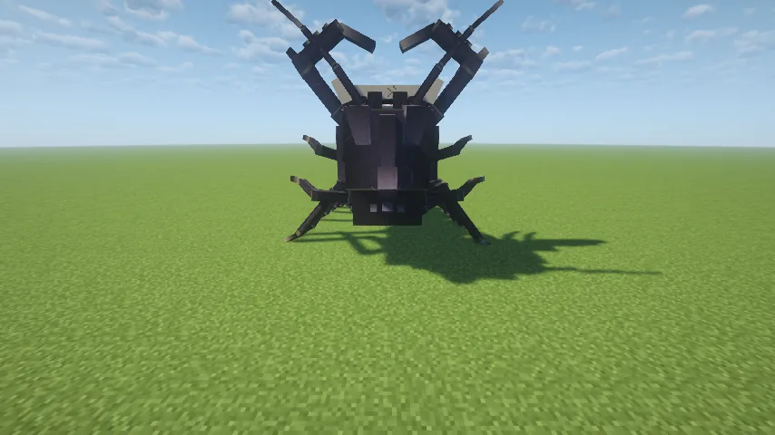
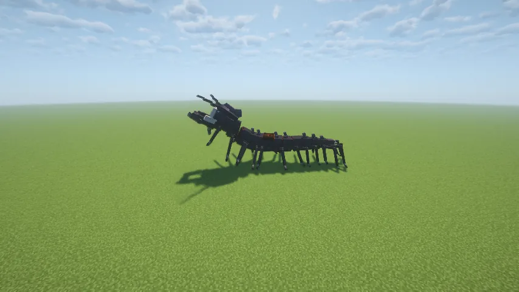
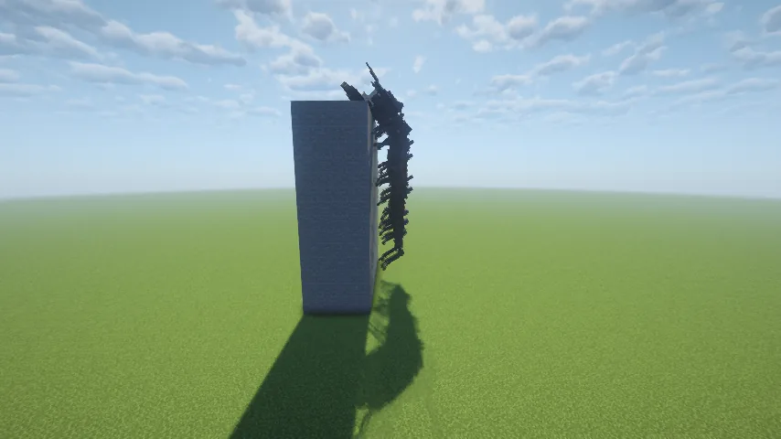
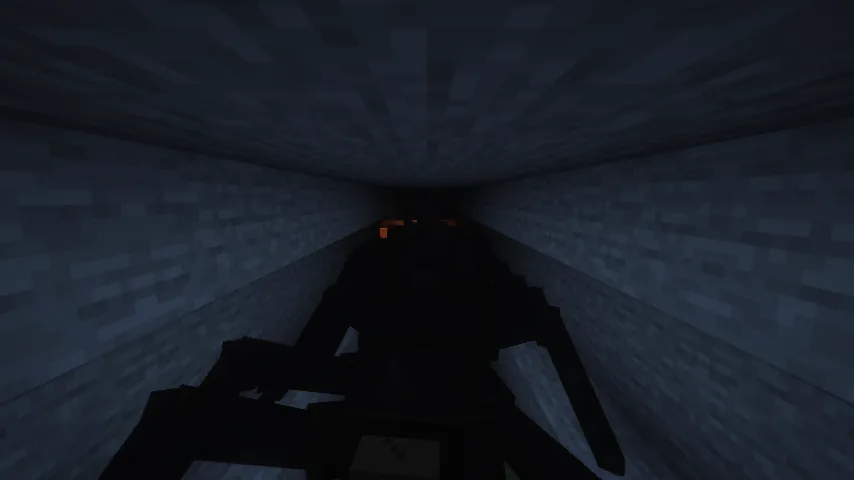
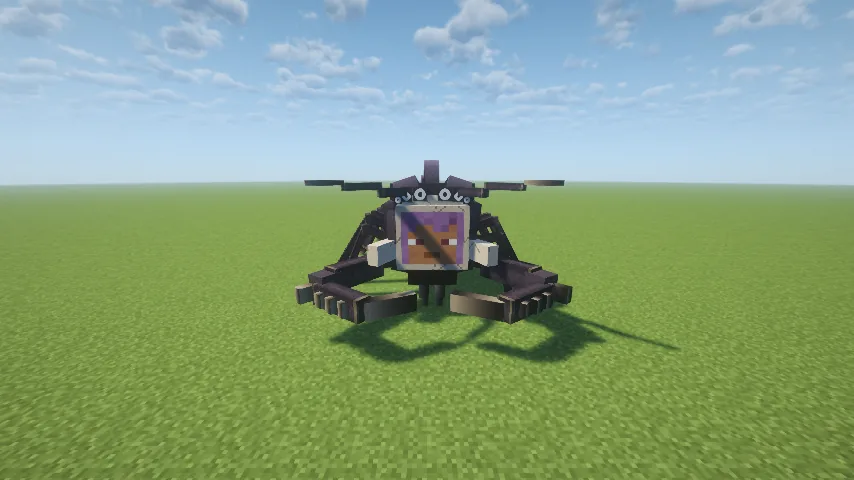
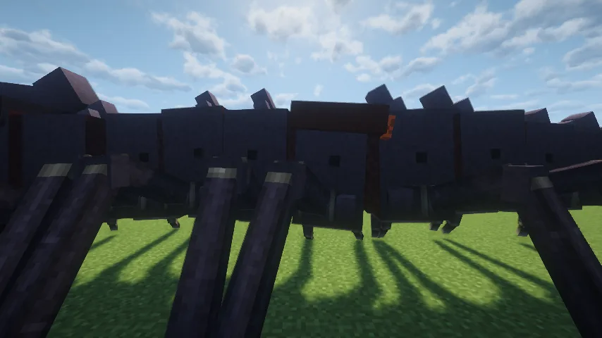
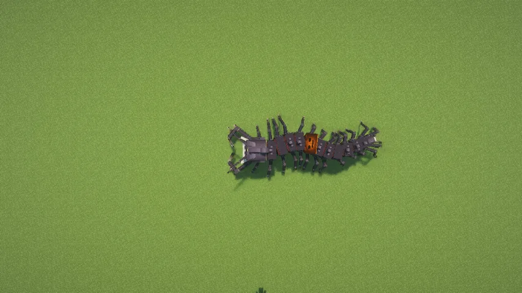
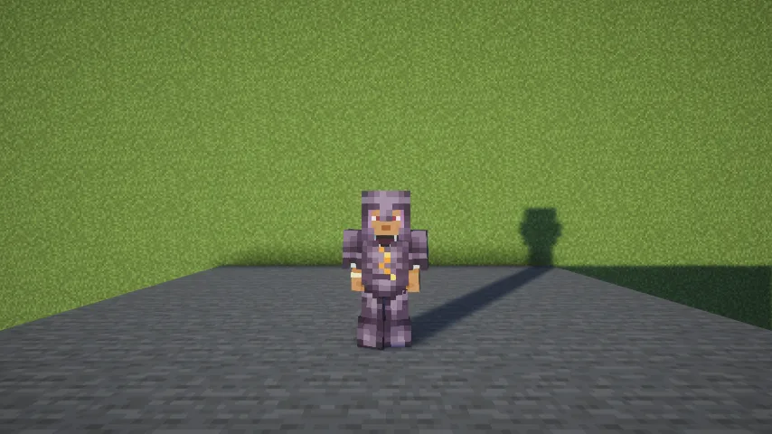

The **Face-Stealer** is nfx's centipede: sixteen blocks of plated body and a mask for a face. It
lives in the rock beside the deep caves, **hears you from far away**, digs through stone to reach
you, and climbs walls and ceilings. If it catches you, it bites, and then it **wears your face**
until its next victim. Kill it and its chitin makes armour that lets you **walk on walls**.

## Where it lives

- In the **deepslate mining band, Y −32 to −8**, but never in the Deep Dark. Shallow caves and
  ordinary iron mining near the surface are outside its territory.
- It spawns in the rock beside a cave and bores a pocket into the wall, so **the first sign of it
  is digging**.
- It never leaves its band. It doesn't chase you up out of it, and it can't grab you outside it.
- **Daylight** on any part of it hurts it, a heart a second. Torches don't, and light stops it
  *spawning* but doesn't scare off one that's hunting.

## How it hunts

- **It listens.** Footsteps, sprinting, mining, building, splashing, fighting and explosions all
  carry, up to **512 blocks**. From far away it gets only a rough direction; within 64 blocks it
  knows exactly where the sound was. Keep making noise and it homes in. **Sneaking is silent.**
- **It stalks.** It comes quietly through the rock, often digging. When it starts stalking you, it
  hisses once.
- **Don't meet its eyes.** A stare (not a glance) starts the **hunt**: a screech, then it comes
  fast, loudly, and pounces from close range, coiling first with a click and a hiss.
- **It's catchable on foot.** At 4.8 blocks a second, a sprinting player can open a gap on clear
  ground. Walking, obstacles and pounces at close range are where it gets you.
- **The lurk:** go up out of its band and it doesn't follow. It digs into the wall beside the
  shaft or stairs you left by and **waits**, a block of rock between it and the way down. Come
  back down within reach and it grabs you from the wall.
- It remembers a target for about two minutes, and the sounds you make keep that memory fresh.

## If it catches you

Its pincers close and **hold you**: you can't get away until it lets go. Then it **bites**, and the
bite kills, through armour, shields and enchantments alike. A **Totem of Undying** still saves
you, and so does a [Miracle Bringer](/wiki/miracle-bringer). Survive the bite and it lets go and
flees.

A player it kills becomes its new face, for everyone to see.

## Fighting it

- **Only its cracked segment can be hurt.** One plate somewhere along its body is cracked and
  **glows like an ember**. A blow anywhere else, the head included, rings off the plating and does
  nothing.
- **Explosions** do half damage wherever they land.
- **At least five blows** kill it, however strong the weapon: no single hit takes more than a fifth
  of its health.

## What it drops

- **12 to 18 Chitin** (more with Looting).
- Its **Cracked Carapace**.
- One time in seven, the **Stolen Face** it wore, naming its victim.
- 50 experience.

## Chitin armour: walking on walls

Chitin makes a full set of armour (netherite's protection, mended with chitin). The chestplate needs
the **Cracked Carapace** at its heart. **Wearing all four pieces lets you walk on walls and
ceilings.**

- **To take a wall:** hold **Jump** while moving forward toward the wall you're looking at.
- **Keep moving** to follow connected walls and ceilings, round corners and over edges. You can let go
  of Jump once you're on.
- **To let go:** release Jump and press it again to jump away.
- You also let go if you take a piece off, or in water or lava, flying, riding, gliding or sleeping.
- Ordinary bumps, steps and walking off ledges stay normal.

## For operators

`/summon aberrantmobs:face_stealer` (or its spawn egg in creative) works only inside its habitat:
underground in its band, outside the Deep Dark, and not on Peaceful. Anywhere else it says why. In
creative it hears you but won't hunt you: only survival and adventure players are prey.
